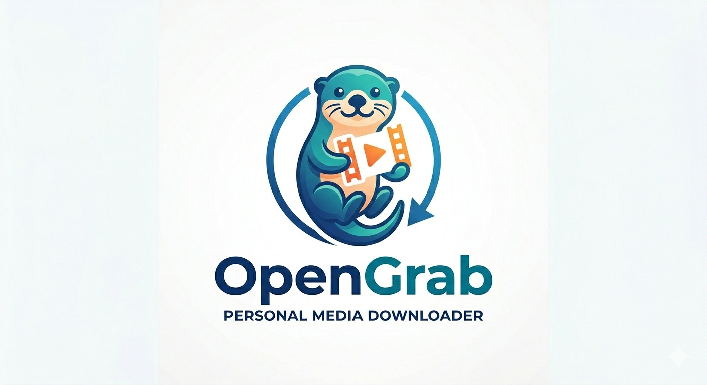

<div align="center">

  <a href="https://github.com/Skydope/OpenGrab">
    <picture>
      <source media="(prefers-color-scheme: dark)" srcset="Logo-dark.png">
      <source media="(prefers-color-scheme: light)" srcset="Logo.png">
      
    </picture>
  </a>

  > Descargador de video y audio autoalojado: pegás una URL de cualquier sitio y te llevás un MP4. Envuelve yt-dlp (más de 1800 sitios) y ffmpeg detrás de una interfaz web prolija.

  [](LICENSE)
  [](https://github.com/Skydope/OpenGrab/releases/latest)
  [](https://www.python.org)
  [](https://github.com/Skydope/OpenGrab/pkgs/container/opengrab)
  [](https://github.com/Skydope/OpenGrab/stargazers)

  [EN](README.md) · **ES**

</div>

> [!CAUTION]
> **OpenGrab es una herramienta autoalojada para uso personal.** Los autores no
> se hacen responsables del uso que le des. Sos el único responsable de cumplir
> con los Términos de Servicio de las plataformas que uses y con las leyes de
> derechos de autor aplicables. Usalo solo con contenido propio, con licencia
> que permita reutilizarlo o amparado por el uso legítimo (fair use).

## Lo más destacado

- Soporte universal (más de 1800 sitios vía yt-dlp)
- Calidades predefinidas: **best**, 1080p, 720p, 480p, MP3
- Playlists completas + **Watch mode** (canales con deduplicación)
- Progreso en tiempo real vía SSE
- Persistencia en SQLite (WAL) + recuperación ante caídas
- **Protección SSRF en dos capas** (DNS a nivel de aplicación + cortafuegos a nivel de host)
- App de escritorio (instalador para Windows con asistente bilingüe)
- Configuración de nginx + TLS lista para producción
- Hot-swap de yt-dlp y builds reproducibles

## Inicio rápido

### Docker (recomendado)

```bash
git clone https://github.com/Skydope/OpenGrab.git && cd OpenGrab
cp .env.example .env
docker compose up -d
```

Abrí `http://localhost:8800`

### Escritorio

Descargá el instalador desde [Releases](https://github.com/Skydope/OpenGrab/releases/latest).

Mirá [docs/INSTALL.md](docs/INSTALL.md) para ver todas las opciones.

## Documentación

Por ahora la documentación detallada está en inglés.

- [Instalación](docs/INSTALL.md)
- [Despliegue en producción](docs/DEPLOY.md)
- [Referencia de la API](docs/API.md)
- [Seguridad](docs/SECURITY.md)
- [Cómo contribuir](docs/CONTRIBUTING.md)
- [Changelog](CHANGELOG.md)

---

## Índice

- [Descripción general](#descripción-general)
- [Funcionalidades](#funcionalidades)
- [Stack tecnológico](#stack-tecnológico)
- [Primeros pasos](#primeros-pasos)
- [App de escritorio](#app-de-escritorio)
- [Uso](#uso)
- [Arquitectura](#arquitectura)
- [Modelo de seguridad](#modelo-de-seguridad)
- [Variables de entorno](#variables-de-entorno)
- [Referencia de la API](#referencia-de-la-api)
- [Nginx (TLS)](#nginx-tls)
- [Cómo contribuir](#cómo-contribuir)
- [Documentación](#documentación)
- [Licencia](#licencia)

---

## Descripción general

OpenGrab es un descargador de video y audio autoalojado para tu homelab o tu red local. Pegás una URL de prácticamente cualquier sitio —YouTube, Vimeo, TikTok, Instagram, X/Twitter, Bandcamp, SoundCloud y miles más—, elegís una calidad y te llevás un archivo MP4 o MP3. Sin extensiones de navegador ni sitios turbios: solo tu propio servidor, o una [app de escritorio para Windows](#app-de-escritorio) si lo preferís.

Está construido sobre [yt-dlp](https://github.com/yt-dlp/yt-dlp) (el motor que soporta más de 1800 sitios) y [ffmpeg](https://ffmpeg.org/) para el muxeo. Todo el backend es una única app FastAPI con un frontend vanilla embebido: cero npm, cero bundlers, cero llamadas a CDN.

---

## Funcionalidades

- Descarga de video en **MP4** (best, 1080p, 720p, 480p) o en **MP3** (solo audio)
- **Soporte universal**: funciona con cualquier sitio que yt-dlp pueda manejar (más de 1800), no solo YouTube
- **Soporte de playlists**: explorá todos los videos de una playlist y descargá en lote los que elijas
- **Clips**: descargá solo un fragmento de tiempo eligiendo el inicio y el fin en una línea de tiempo con dos controles, o escribiendo `MM:SS`; funciona para video y para mp3, y en HLS/DASH baja solo los fragmentos necesarios
- Progreso en tiempo real vía **Server-Sent Events** (SSE), sin la complejidad de WebSocket
- **Historial de descargas** persistido en SQLite (modo WAL), con recuperación ante caídas
- **Autenticación por token** opcional para restringir el acceso (`OPENGRAB_TOKEN`)
- **Mensajes de error comprensibles**, con un botón para reintentar las descargas fallidas
- **Hot-swap de yt-dlp**: actualizá el motor de descarga desde la interfaz o al iniciar la app de escritorio, sin recompilar
- Límites configurables: máximo de descargas simultáneas, tamaño máximo por archivo y espacio total en disco
- **Protección SSRF en capas**: la validación DNS a nivel de aplicación bloquea IPs privadas, loopback y endpoints de metadatos de la nube; un cortafuegos de salida opcional a nivel de host cierra el DNS rebinding en la capa de red
- **yt-dlp fijado** en la imagen para tener builds reproducibles, y mantenido al día con Dependabot. Si necesitás la última corrección al instante, podés activar la actualización automática al iniciar el contenedor (`OPENGRAB_AUTOUPDATE=1`)
- Configuración de **proxy inverso nginx** lista para producción, con TLS, ajustes compatibles con SSE y cabeceras de seguridad
- **App de escritorio para Windows**: ventana nativa con pywebview + WebView2, ícono en la bandeja del sistema, instancia única y asistente de instalación (español/inglés)

---

## Stack tecnológico

| Capa | Tecnología | Notas |
|------|-----------|-------|
| Runtime | Python 3.11+ | — |
| Framework web | FastAPI + uvicorn | Asíncrono, guiado por tipos |
| Motor de descarga | yt-dlp | Corre en un pool de hilos (E/S bloqueante) |
| Procesamiento de video | ffmpeg | Binario del sistema, muxeo a MP4 |
| Datos | SQLite (modo WAL) | Persistencia de trabajos, recuperación ante caídas, historial |
| Frontend | Alpine.js + CSS vanilla | Embebido, sin CDN, tema oscuro/claro |
| Contenedor | Docker + Compose | Una sola imagen, con healthcheck incluido |
| Proxy inverso | nginx | Opcional, con soporte de TLS y SSE |
| Escritorio | pywebview + pystray | App para Windows, bandeja del sistema, WebView2 |

---

## Primeros pasos

### Instalación manual

¿Preferís configurar todo vos? Este es el camino directo.

**Requisitos previos**

- **Docker** >= 24.x (recomendado), o bien
- **Python** 3.11+ con `pip`
- **ffmpeg** en el PATH (viene incluido en la imagen de Docker; sin Docker: `apt install ffmpeg`, `brew install ffmpeg` o `pacman -S ffmpeg`)

```bash
git clone https://github.com/skydope/opengrab.git
cd opengrab

# Copiá y configurá las variables de entorno
cp .env.example .env
# Editá .env si querés definir un token o cambiar los valores por defecto

# Levantalo con Docker Compose
docker compose up -d
# http://localhost:8800
```

> [!TIP]
> Para usarlo sin Docker, ejecutá `pip install -r requirements.txt` y después `python app.py`. Asegurate de tener ffmpeg en el PATH.

---

## App de escritorio

| Plataforma | Descarga | Formato |
|------------|----------|---------|
| Windows | `OpenGrab-Setup.exe` | Asistente de instalación (español/inglés) |
| Linux | `OpenGrab-x86_64.AppImage` | Ejecutable portable |
| macOS | `OpenGrab-macos.zip` | Bundle de aplicación |

Todas las descargas incluyen ffmpeg y yt-dlp, con soporte de hot-swap.

Descargalas desde la [última release](https://github.com/Skydope/OpenGrab/releases/latest).

### Notas por plataforma

**Windows:** asistente de instalación con modo Recomendado (valores por defecto) y modo
Avanzado (carpeta, puerto, contraseña e inicio automático a elección). Ventana nativa con
WebView2 (pywebview), que se instala en silencio si falta. Soporte de bandeja del sistema.

**Linux:** AppImage — `chmod +x OpenGrab-x86_64.AppImage && ./OpenGrab-x86_64.AppImage`.
Abre tu navegador predeterminado (sin ventana nativa). Bandeja del sistema vía D-Bus/pystray.
Requiere un entorno de escritorio con área de indicadores (GNOME, KDE, XFCE, etc.).

**macOS:** descomprimí y ejecutá `OpenGrab.app`. Ventana nativa con Cocoa WebKit (pywebview).
Soporte de bandeja del sistema. La primera vez puede que tengas que hacer clic derecho → Abrir
(Gatekeeper).

---

## Uso

1. Abrí `http://localhost:8800` en tu navegador
2. Si definiste `OPENGRAB_TOKEN`, ingresá el token cuando te lo pida (se guarda en una cookie HTTP-only que vence a los 30 días)
3. Pegá una URL de cualquier sitio soportado y hacé clic en **Analizar**
4. Elegí una calidad: `best mp4`, `1080p`, `720p`, `480p` o `solo audio · mp3`
5. Hacé clic en **Descargar**: el progreso aparece en el área de salida estilo terminal
6. Cuando termine, hacé clic en el enlace de descarga para guardar el archivo

Con las playlists, en el paso 3 se detecta la URL y aparece el panel de playlist. Seleccioná los videos que quieras y hacé clic en **Descargar playlist**.

---

## Arquitectura

```
opengrab/
├── app.py              # Entrypoint (~120 lines)
├── config.py           # Environment + config.ini
├── state.py            # AppState — runtime jobs, events, eviction
├── db.py               # SQLite data layer (WAL, crash recovery)
├── models.py           # Pydantic models
├── download.py         # yt-dlp wrappers + error mapping
├── routes.py           # API endpoints (APIRouter, 26 endpoints)
├── desktop.py          # Windows desktop launcher (pywebview)
├── engine_update.py    # yt-dlp hot-swap via PyPI wheel
├── static/
│   ├── index.html      # Alpine.js SPA
│   ├── style.css       # Dark/light theme, WCAG AA
│   └── alpine.min.js   # Embedded (~43KB), no CDN
├── tests/              # pytest tests (~111 tests)
├── vendor/             # Bundled ffmpeg + app icon
├── nginx/              # Reverse proxy TLS config
├── Dockerfile          # Non-root user, healthcheck
├── docker-compose.yml
├── OpenGrab.spec       # PyInstaller build spec
└── opengrab.iss        # Inno Setup installer wizard
```

**Decisiones de diseño clave:**
- **Backend asíncrono + pool de hilos.** FastAPI atiende el HTTP y yt-dlp corre en `asyncio.to_thread()` para no bloquear el event loop.
- **SSE en lugar de WebSockets.** Las actualizaciones de progreso usan `asyncio.Event` con un bucle de sondeo con timeout de 2 segundos. Es más simple que WebSockets y no suma dependencias.
- **Estado en RAM + SQLite.** El estado de los trabajos (progreso, velocidad, tiempo restante) vive en memoria para enviarlo por SSE en tiempo real. Las transiciones de estado (queued → downloading → done) se persisten en SQLite (modo WAL). El historial se lee de la base de datos. Los trabajos viejos se eliminan de la memoria después de 1 hora.
- **Frontend pensado para funcionar sin conexión.** Alpine.js va embebido (~43KB) y el CSS usa variables para los temas. No hace llamadas a CDN y funciona por completo dentro de la red local.

---

## Modelo de seguridad

OpenGrab aplica una **defensa contra SSRF en 2 capas**, porque funciona como un proxy: yt-dlp hace peticiones HTTP desde tu servidor hacia URLs arbitrarias.

### Capa 1 — Validación DNS a nivel de aplicación (`download.py`)

La función de control `_is_safe_url()` se ejecuta antes de que cualquier URL llegue a yt-dlp:

1. **Restricción de esquema**: solo `http` y `https` (bloquea `file://`, `ftp://`, `javascript:`, `data:`)
2. **Lista de hosts bloqueados**: `localhost`, `0.0.0.0`, `::1`, `.local`, `.localhost`
3. **Control de IPs literales**: si la URL contiene una dirección IP, la valida contra:
   - Privadas (`10.0.0.0/8`, `172.16.0.0/12`, `192.168.0.0/16`)
   - Loopback (`127.0.0.0/8`, `::1`)
   - Link-local (`169.254.0.0/16`, que incluye el endpoint de metadatos de la nube `169.254.169.254`)
   - Reservadas, multicast y no especificadas
4. **Resolución DNS**: si la URL tiene un nombre de dominio, resuelve **todas** las IPs (A + AAAA)
   con `getaddrinfo` y valida cada una. Así se cierra el bypass clásico en el que un dominio como
   `evil.com` tiene un registro A que apunta a `10.0.0.5`.
5. **Estricto ante fallos**: si la resolución DNS falla, la petición se bloquea; un falso negativo
   transitorio es más seguro que un bypass silencioso de SSRF. Las IPv6 ULA (`fc00::/7`) y las
   IPv6 con IPv4 mapeada (`::ffff:10.0.0.5`) quedan cubiertas por `is_private` (CPython 3.12+).

Los mensajes de error son distintos según el caso: "no se pudo resolver el host" (fallo de DNS) o
"el host resuelve a una IP privada o reservada" (intento de SSRF).

> [!NOTE]
> La capa 1 no puede evitar del todo el DNS rebinding (TOCTOU). Entre la resolución DNS del
> control y la conexión propia de yt-dlp, un servidor DNS malicioso podría cambiar la respuesta.
> La capa 2 cierra ese hueco.

### Capa 2 — Cortafuegos de salida a nivel de host (opcional, recomendado)

Para tener defensa en profundidad, bloqueá a nivel de red el tráfico saliente del contenedor hacia rangos privados:

```bash
# Previsualizá las reglas antes de aplicarlas
sudo ./scripts/egress-lockdown.sh --dry-run

# Aplicalas en la cadena DOCKER-USER (solo afecta al contenedor de OpenGrab)
sudo ./scripts/egress-lockdown.sh --apply

# Opcional: registrá los intentos bloqueados (con límite de frecuencia, en kern.log)
sudo ./scripts/egress-lockdown.sh --apply --log

# Verificá
sudo ./scripts/egress-lockdown.sh --list

# Quitalas
sudo ./scripts/egress-lockdown.sh --remove
```

**Decisiones de diseño:**
- Las reglas viven en la cadena `DOCKER-USER` del **host** (que se evalúa antes que las reglas
  propias de Docker). El contenedor no necesita la capability `NET_ADMIN`, así que se mantiene el
  modelo actual de usuario no-root `USER opengrab`. Funciona con Docker rootless siempre que
  iptables corra en el host.
- **Acotadas a la subred del contenedor** (detectada con `docker inspect`). Solo bloquean el tráfico
  del contenedor de OpenGrab: los demás servicios de tu homelab (Grafana, Home Assistant, etc.)
  no se ven afectados.
- La subred del propio contenedor queda **exceptuada** (regla `RETURN`) para permitir el acceso al
  gateway (NAT hacia internet) y la comunicación entre pares.
- `127.0.0.0/8` **no se bloquea**: el resolvedor DNS embebido de Docker vive en `127.0.0.11`
  dentro del namespace de red del contenedor y no pasa por DOCKER-USER. El SSRF hacia loopback ya
  lo cubre la capa 1.

**IPv6:** si Docker tiene IPv6 habilitado, el script agrega reglas de `ip6tables` para ULA
(`fc00::/7`), link-local (`fe80::/10`) y loopback (`::1`). Una alternativa más simple para un
descargador de videos (en la práctica, las CDN entregan por IPv4) es deshabilitar IPv6 en el
contenedor descomentando esto en `docker-compose.yml`:

```yaml
sysctls:
  - net.ipv6.conf.all.disable_ipv6=1
```

> [!WARNING]
> Las reglas de `DOCKER-USER` son efímeras: se pierden cuando recreás la red de Docker o
> reiniciás el daemon de Docker. Volvé a ejecutar `--apply` (es idempotente) o asocialo a un
> hook de systemd que se dispare después de `docker.service`.

### Resumen

| Amenaza | Capa 1 (aplicación) | Capa 2 (red) |
|---------|--------------------|--------------|
| IP literal hacia un rango privado | Bloqueada | Descartada |
| Dominio → IP privada | Bloqueada (resolución DNS) | Descartada |
| DNS rebinding | No cubierto (TOCTOU) | Descartada |
| `file://`, `ftp://`, etc. | Bloqueada (restricción de esquema) | — |
| Metadatos de la nube (`169.254.169.254`) | Bloqueada (link-local) | Descartada |

---

## Variables de entorno

| Variable | Obligatoria | Por defecto | Descripción |
|----------|-------------|-------------|-------------|
| `OPENGRAB_HOST` | No | `127.0.0.1` | Dirección de escucha (`0.0.0.0` para Docker) |
| `OPENGRAB_PORT` | No | `8800` | Puerto del servidor HTTP |
| `OPENGRAB_DIR` | No | `./downloads` | Carpeta de salida de los archivos descargados |
| `OPENGRAB_TOKEN` | No | — | Si está definida, exige un token Bearer en todas las rutas `/api/*`. Si está vacía, se genera una automáticamente al iniciar. |
| `OPENGRAB_NO_AUTH` | No | — | Poné `1` para desactivar la autenticación (solo para desarrollo/uso local) |
| `OPENGRAB_MAX_JOBS` | No | `2` | Máximo de descargas simultáneas |
| `OPENGRAB_MAX_SIZE_MB` | No | `0` (ilimitado) | Tamaño máximo por archivo |
| `OPENGRAB_MAX_TOTAL_MB` | No | `0` (ilimitado) | Espacio total en disco: al superarlo, rechaza trabajos nuevos con HTTP 507 |
| `OPENGRAB_AUTOUPDATE` | No | `0` | Actualiza yt-dlp automáticamente al iniciar el contenedor. Hay que activarla explícitamente. |
| `OPENGRAB_YTDLP_VERSION` | No | — | Fija una versión concreta de yt-dlp cuando la actualización automática está activada |
| `OPENGRAB_TRUST_XFF` | No | `0` | Confía en `X-Forwarded-For` para el límite de peticiones (activala detrás de nginx) |
| `OPENGRAB_CONFIG` | No | — | Ruta personalizada a `config.ini` (modo escritorio) |

Mirá [`.env.example`](.env.example) para tener una plantilla lista para copiar.

---

## Referencia de la API

Todos los endpoints `/api/*` requieren autenticación, salvo que `OPENGRAB_NO_AUTH=1`. Si `OPENGRAB_TOKEN` está vacía, se genera un token automáticamente al iniciar y se muestra en los logs. Podés autenticarte con:
- La cabecera `Authorization: Bearer <token>`
- El parámetro de consulta `?token=<token>`
- La cookie HTTP-only `opengrab_token` (la define `POST /api/auth` y vence a los 30 días)

### Núcleo

| Método | Ruta | Límite | Descripción |
|--------|------|--------|-------------|
| `GET` | `/` | — | Interfaz web |
| `GET` | `/health` | — | Chequeo de salud (devuelve `{"status":"ok"}`) |
| `POST` | `/api/auth` | — | Autentica y devuelve la cookie — body: `{"token":"..."}` |
| `POST` | `/api/logout` | — | Borra la cookie de autenticación |
| `GET` | `/api/info?url=...` | 10/min | Obtiene los metadatos del video y los formatos disponibles |
| `POST` | `/api/jobs` | 5/min | Crea un trabajo de descarga — body: `{"url":"...", "quality":"best"}` |
| `GET` | `/api/jobs/{id}/events` | — | Stream SSE con el progreso de un trabajo |
| `GET` | `/api/jobs/{id}/file` | — | Descarga el archivo terminado |
| `POST` | `/api/jobs/{id}/open-folder` | — | Abre el explorador de archivos en el archivo descargado |
| `POST` | `/api/engine/update` | 2/min | Fuerza el hot-swap de yt-dlp |

### Playlists y lotes

| Método | Ruta | Límite | Descripción |
|--------|------|--------|-------------|
| `GET` | `/api/playlist?url=...` | 10/min | Obtiene las entradas de una playlist |
| `POST` | `/api/playlist/download` | 2/min | Encola hasta 100 URLs de una playlist — body: `{"urls":[...], "quality":"best"}` |
| `GET` | `/api/jobs/batch-status?ids=...` | — | Estado de varios trabajos de un lote (IDs separados por comas) |

### Historial

| Método | Ruta | Límite | Descripción |
|--------|------|--------|-------------|
| `GET` | `/api/history?limit=20` | — | Historial de descargas en JSON |
| `DELETE` | `/api/history/{job_id}` | — | Borra una entrada del historial (el archivo y el workdir se borran de forma segura en segundo plano) |
| `DELETE` | `/api/history` | 5/min | Borra todo el historial (elimina los archivos del disco) |

### Almacenamiento

| Método | Ruta | Límite | Descripción |
|--------|------|--------|-------------|
| `GET` | `/api/storage` | — | Uso total, desglose por workdir, archivos sueltos y tamaño de la base de datos |
| `POST` | `/api/storage/cleanup` | 5/min | Borra los workdirs viejos — body: `{"max_age_hours":24}` |
| `POST` | `/api/storage/cleanup-all` | 3/min | Borra todos los workdirs |

### Configuración

| Método | Ruta | Límite | Descripción |
|--------|------|--------|-------------|
| `GET` | `/api/settings` | — | Catálogo de todos los ajustes con sus valores actuales y metadatos |
| `PUT` | `/api/settings` | 10/min | Actualiza los ajustes — body: `{"max_jobs":3, ...}` |

### Canales (Watch mode)

| Método | Ruta | Límite | Descripción |
|--------|------|--------|-------------|
| `GET` | `/api/channels` | — | Lista todos los canales (habilitados y deshabilitados) |
| `POST` | `/api/channels` | 10/min | Agrega un canal — body: `{"url":"...", "quality":"best", "interval_minutes":60}` |
| `PUT` | `/api/channels/{id}` | 10/min | Actualiza campos del canal (título, calidad, intervalo, habilitado) |
| `DELETE` | `/api/channels/{id}` | 10/min | Borra un canal |
| `POST` | `/api/channels/{id}/check` | 5/min | Fuerza una búsqueda manual de videos nuevos |

### `POST /api/jobs`

**Cuerpo de la petición:**
```json
{
  "url": "https://www.youtube.com/watch?v=...",
  "quality": "best"
}
```

`quality` tiene que ser uno de estos valores: `best`, `1080p`, `720p`, `480p`, `audio`.

**Respuesta:**
```json
{"job_id": "a1b2c3d4e5f6"}
```

### `GET /api/jobs/{id}/events`

Stream SSE. Cada evento es una instantánea en JSON:
```json
{"status":"downloading","percent":45.3,"speed":"12.3MiB/s","eta":"00:42","note":"","filename":"","error":""}
```

Al terminar: `"status": "done"`, con `"filename"` completo.
Si hay un error: `"status": "error"`, con el mensaje en `"error"`.

---

## Nginx (TLS)

En `nginx/opengrab.conf` hay una configuración de nginx lista para producción. Copiala en la carpeta `conf.d/` de tu nginx. Se encarga de:

- Redirigir de HTTP a HTTPS
- Terminar TLS (apuntá `ssl_certificate` a tu certificado)
- Ajustes compatibles con SSE (`proxy_buffering off`, timeouts de 3600 s)
- Cabeceras de seguridad (HSTS, X-Frame-Options, X-Content-Type-Options)
- Usar el resolvedor DNS de Docker, para que nginx arranque aunque opengrab esté caído por un momento

---

## Cómo contribuir

Las contribuciones son bienvenidas. Seguí estos pasos:

1. Hacé un fork del repositorio
2. Creá una rama para tu cambio (`git checkout -b feat/tu-cambio`)
3. Hacé commit de tus cambios siguiendo [Conventional Commits](https://www.conventionalcommits.org/)
4. Hacé push y abrí un Pull Request

> [!NOTE]
> Los issues y PRs en español son bienvenidos.

---

## Licencia

Distribuido bajo la [Licencia MIT](LICENSE). Mirá `LICENSE` para más detalles.
